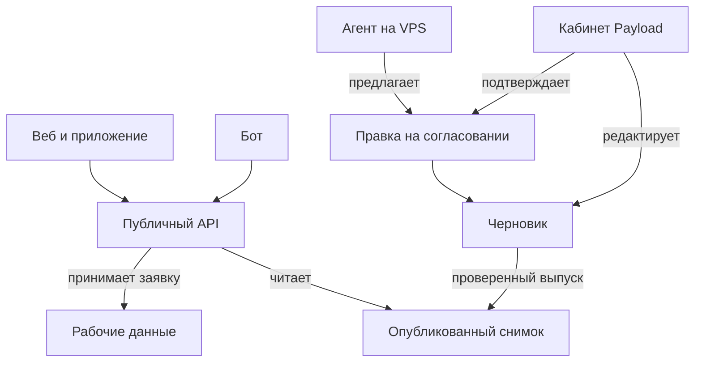

# Развёртывание и границы системы

Эта страница описывает контур веб-пилота и его эксплуатационные ориентиры. Общие правила модулей, внешних сред разработки, MCP и границы текущей реализации приведены в [архитектуре фреймворка](modular-framework.md).

Один бизнес владеет форком и одним автономным контуром проекта. В этом контуре могут работать сайт, кабинет владельца, приложение для покупателей и несколько ботов. Локальная эксплуатация не требует доступности репозитория автора, оплаты центральной подписки или передачи обращений клиентов автору базы. Удалённая модель, внешние каналы и магазины имеют собственные условия доступности.

## Что читает опубликованная версия

Покупатель видит зафиксированную редакцию сайта, пока владелец и агенты работают над новой. Операционные записи живут отдельно от содержимого выпуска. На схеме сплошные линии показывают разрешённые прикладные операции; роли БД и сетевые правила ограничивают доступ независимо от интерфейса.

## Границы компонентов

| Компонент | Технология и доступ | Для чего нужен |
| --- | --- | --- |
| Входная точка | Caddy, HTTPS. Отдельные домены или origin для сайта, кабинета и временного предпросмотра | Принимает внешний трафик. Публичные запросы идут по явному списку маршрутов. У предпросмотра нет cookies владельца. |
| Публичный сайт | Next.js, React, TypeScript. Для простой страницы возможен статический выпуск | Отдаёт HTML, одобренные медиа и формы. Читает опубликованный снимок. Отправка заявки идёт через прикладной метод с валидацией и ограничением частоты. |
| Кабинет владельца | Payload, собственное React-представление редактора | Вход, роли, страницы, виджеты, документы, чат блока, версии и согласование. Изменение выполняется с правами конкретного субъекта. |
| Доменный API | Модули TypeScript и версионированные DTO; публичный API исполняется с урезанными правами, кабинет использует тот же слой операций | Общие операции сайта, телефона и бота. Внешние клиенты не зависят от имён внутренних коллекций Payload и схемы SQL. |
| Мобильный клиент | Expo и React Native, релиз в аккаунтах предпринимателя | Имеет свой набор нативных рендереров и кэш последнего совместимого выпуска. Веб и native используют одни договорённости о данных. |
| Рабочие процессы | Node.js; бот, обработчик задач, индексирование базы знаний; события и очередь в Postgres | Обрабатывают работу вне HTTP-запроса; перезапускаются независимо от кабинета. Раздельные сервисные пользователи и разрешения. |
| Сборка и доставка | Изолированный одноразовый сборщик и отдельный ограниченный процесс выпуска | Первый получает временную копию кода и синтетические данные. Второй проверяет одобренный артефакт и переключает трафик. |
| Состояние | PostgreSQL, pgvector при необходимости семантического поиска, закрытое S3-совместимое хранилище и реестр OCI | Снимки контента, бизнес-данные, оригиналы файлов, результаты сборок и резервные копии имеют разных владельцев и режимы доступа. |

На старте достаточно Docker Compose на Linux VPS. Публикуются порты входной точки. БД и служебные порты доступны в приватных сетях. У студии, публичного API, ботов и исполнителя отдельные роли БД. Приложения не монтируют сокет Docker и домашний каталог администратора. Недоверенные сборки выполняются на отдельном runner или во временной изолированной VM. Обычный контейнер Compose на продовом хосте не даёт необходимую изоляцию для произвольного сгенерированного кода.

Если маркетинговая кампания создаёт очередь, первым масштабируется обработчик задач. При нехватке дисковой производительности отдельно выносится Postgres. Условие перехода к нескольким узлам — измеримая нагрузка или заявленная доступность, требующая пережить потерю VPS. Одна машина с Compose остаётся одной точкой отказа.

## Идентичность и секреты

Первичное развёртывание выполняет владелец или его администратор на своём хосте. Первый владелец регистрируется через одноразовое локальное приглашение, публичная саморегистрация администраторов закрыта. Учётные записи сотрудников, покупателей, ботов, CI и исполнителя разделены. Для владельца и выпуска предусмотрен второй фактор через выбранного поставщика идентификации. Браузер использует защищённую сессионную cookie; операции записи имеют защиту от CSRF. Мобильный публичный клиент при входе использует короткоживущий токен и OAuth/OIDC Authorization Code с PKCE, токен обновления хранит в системном защищённом хранилище.

Профиль модели содержит ссылку на секрет и разрешённый адрес API. Сам ключ читается только процессом, которому он нужен. Для первого self-hosted комплекта допустимы файлы секретов с ограниченным доступом вне Git, по мере роста — внешнее хранилище секретов. Бэкап секретов восстанавливается по отдельному каналу. Ключи тестовой и промышленной среды различаются. Для вызовов Payload Local API от имени пользователя сервер передаёт проверенного пользователя и явно задаёт `overrideAccess: false`.

[Документация Payload Admin](https://payloadcms.com/docs/admin/overview) · [Права при вызове Local API](https://payloadcms.com/docs/local-api/access-control) · [Docker Compose в промышленной среде](https://docs.docker.com/compose/how-tos/production/)
